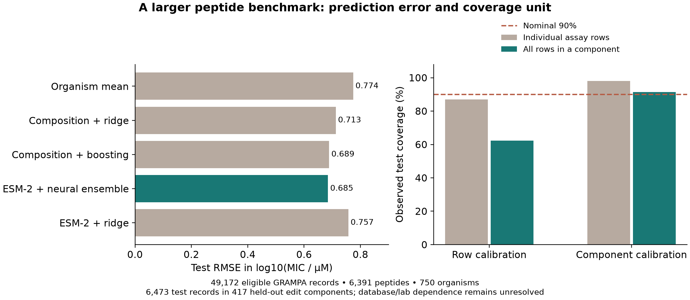

# Species-conditioned MIC prediction and component coverage

The larger study uses all **49,172 eligible GRAMPA records**, covering **6,391 sequences and 750 organisms**. A frozen **35M-parameter ESM-2 transformer** supplies sequence representations. Three trainable neural heads combine those representations with organism embeddings, composition/length and inherited chemistry flags to predict the mean and scale of log10 MIC.

The model is trained, evaluated and released here. It is not a claim of a new foundation model or experimentally validated peptide discovery.



## What the completed run shows

On 6,473 records in 417 unseen sequence-edit components, the neural ensemble reaches **RMSE 0.685 log10 µM** and **Pearson correlation 0.490**. Composition/species/chemistry gradient boosting reaches **RMSE 0.689**. The difference is small; the report includes a paired component bootstrap and makes no superiority claim.

The useful distinction is the uncertainty unit. Row-residual calibration yields **87.0% row coverage**, but every assay in a held-out component is covered for only **62.4% of components**. Calibrating to each calibration component's maximum normalized error yields **91.4% simultaneous component coverage** and **98.1% row coverage**. Median interval width increases from **1.98 to 3.09 log10 units**. Wider coverage is not a better potency estimate, and these broad intervals limit practical ranking usefulness.

The component calibration assumes exchangeability of whole components; unresolved source/lab dependence prevents an unconditional coverage guarantee. These are observations on a locked retrospective split, not clinical performance or calibrated confidence in a new arbitrary query.

## Reproduce

From the repository root after installing `requirements-study.txt`:

```bash
python large_study/build_dataset.py
HF_HOME=./cache python large_study/encode.py --device mps
python large_study/train.py --device mps
python large_study/summarize.py
```

Use `--device cuda` on an NVIDIA GPU or `--device cpu` when needed. The included run used the Apple M3 GPU through MPS. Training selects checkpoints on validation NLL with a 40-epoch cap and eight-epoch patience; actual histories/epoch counts are retained. Validation deteriorated early in this run, so the released checkpoints do not represent 40 successful epochs.

The frozen-transformer ridge comparator was added with fixed alpha=10 after initial head training to separate representation choice from neural-head choice. No head, hyperparameter or test subset was changed because of this comparison. It is incorporated into `train.py` for future full reproduction; `add_frozen_baseline.py` adds it to existing artifacts without retraining the ensemble.

## Run the released prediction heads

```bash
HF_HOME=./cache python large_study/predict.py large_study/example-query.json --device cpu
```

This downloads the pinned upstream ESM-2 weights if absent and uses the three small released head checkpoints. Organism names must match the training dictionary; unknown names are reported. Missing chemistry is marked unknown, not converted to an unmodified all-L molecule. Output is in log10 MIC units and is a model prediction only.

## Inspect

- [Dataset card](DATASET_CARD.md), [source/split manifest](data/manifest.json), [split ledger](data/split-ledger.csv)
- [Fixed local protocol](protocol.json), [encoder manifest](data/embedding-manifest.json)
- [Training history](results/training.csv), [trained checkpoints](results/checkpoints)
- [Test predictions](results/test-predictions.csv), [metrics and calibration report](results/report.json)

Normalization and organism dictionaries use training only. Checkpoint selection uses validation only. Interval multipliers use calibration only. Test predictions remain available even when a baseline matches or beats the neural model.

## What this adds, and what it does not

QMAP, PathoMIC, IBM's peptide generalization work and conformal prediction literature already address related modeling and evaluation problems. This implementation contributes a specific large-record benchmark recipe and a simultaneous component-coverage audit with inspectable splits, neural heads and raw results. There is no field-first claim.

The source is processed point-valued data without original censoring operators or publication IDs. Species and strain labels are heterogeneous; strains are not separately modeled. Modification flags are incomplete, and protein-model pretraining overlap is unknown. Independent cohort validation, chemistry reconstruction and comparison on established external benchmark splits remain necessary before claiming a field advance.

Code and analysis were developed with Codex. External data/model sources retain their terms; no reviewer, collaborator endorsement or downstream adoption is implied.
