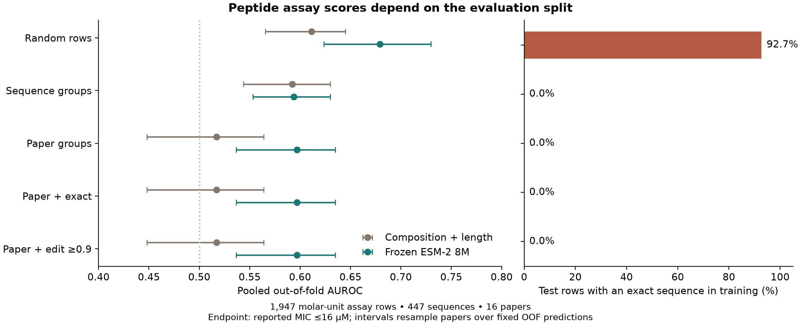

# What changes when peptide assays are split by source?

This study asks whether a protein representation’s low-MIC classification score survives changing the evaluation unit. It compares the same two model pipelines under five fold protocols and records both performance and exact sequence overlap.

After the declared exclusions, the public table contributes 1,947 assay rows, 447 sequences and 16 papers. The endpoint is reported MIC ≤16 µM. Above-threshold rows are NOT an experimentally inactive class; the source itself was selected for antimicrobial evidence.

| Split | Composition + length AUROC | Frozen ESM-2 8M AUROC | Exact sequence overlap in test rows |
|---|---:|---:|---:|
| random_row | 0.611 [0.565, 0.645] | 0.679 [0.623, 0.730] | 92.7% |
| sequence | 0.592 [0.544, 0.630] | 0.594 [0.553, 0.630] | 0.0% |
| paper | 0.517 [0.448, 0.564] | 0.597 [0.537, 0.635] | 0.0% |
| joint_exact | 0.517 [0.448, 0.564] | 0.597 [0.537, 0.635] | 0.0% |
| joint_edit_0.9 | 0.517 [0.448, 0.564] | 0.597 [0.537, 0.635] | 0.0% |

The random split places an already-seen letter sequence in training for 92.7% of held-out assay rows. Sequence and paper groups remove this exact overlap. The ESM probe’s score falls under both grouped protocols. Split changes also change training distributions, so the observed difference cannot be assigned entirely to memorization. Organisms are pooled and not modeled, and chemistry is incompletely specified.

The joint paper/sequence graph adds no source merges in this filtered study: it has 16 components for 16 papers. All 51 edit-similarity edges stay within a source component. Canonical group labels make the equivalent paper, joint-exact and joint-edit partitions produce identical folds and identical scores. This lack of added constraint is a result, not a reason to invent another benchmark win.

The earlier five exact cross-paper matches were found in the complete assay table. Those shared sequences do not remain in the molar-unit eligible subset here; the two reports have different denominators. There is no contradiction between the original overlap audit and zero cross-paper overlap in this experiment.

## Methods and exclusions

Composition features are 20 amino-acid frequencies plus length. ESM features are final-layer residue means from the pinned 8M checkpoint, excluding special tokens and padding. Both classifiers use StandardScaler and class-balanced logistic regression (C=1), fitted only on each training fold. No test-driven hyperparameter search was performed. Five folds are used for every protocol. The study protocol was fixed locally and then corrected for invariance to group-label renaming; it was not externally preregistered.

Excluded rows: 107 missing/unparsed MICs and 395 mass-unit MICs without chemistry-specific molecular weight. These exclusions are not false-positive findings. Full row-level reasons are in `exclusions.json`.

Intervals resample whole papers 2,000 times over fixed out-of-fold predictions. They do not include retraining variability, are not prospective clinical confidence intervals and are not a significance test. Individual folds can have different class mixtures; both pooled metrics and fold-level AUROCs are retained.

## Inspect and reproduce

`predictions.csv` contains row IDs, sequences, papers, labels, fold IDs, probabilities and overlap flags for all ten model/protocol runs. `embeddings.npz` contains the frozen sequence representations. `components.json` records the graph and its source membership. `report.json` pins source/model/protocol hashes and package versions.

Install the sibling [bio-evidence](https://github.com/aarnavbhat23/bio-evidence) package and `requirements-study.txt`, then run `HF_HOME=./cache python run_study.py`. `--skip-esm` reruns the composition model only. `--source-file` accepts a local copy whose hash is recorded. `python plot_study.py` only plots the saved results.

## Relation to existing work

[IBM’s PeptideGeneralizationBenchmarks](https://github.com/IBM/PeptideGeneralizationBenchmarks), [QMAP](https://pmc.ncbi.nlm.nih.gov/articles/PMC13473575/) and existing homology-aware benchmarks already study peptide generalization. Connected components, edit distance, frozen probes and group cross-validation are established methods. This contribution is a reproducible source-aware sensitivity analysis on this specific assay table, with conservative label formation and inspectable failure cases. No field-first algorithm, experimentally validated discovery or competitive model result is claimed.
